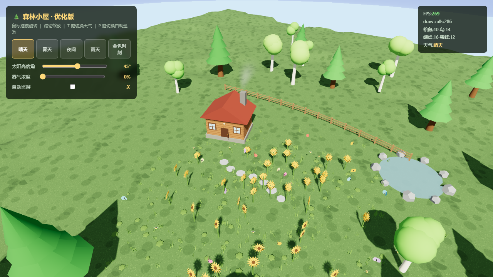

# 森林小屋 · Three.js 场景

一个可交互的森林小屋 3D 场景：小屋、树上松鼠与小鸟、满场向日葵与杂草、蝴蝶蜜蜂萤火虫、
水塘石板路，五种天气（晴天 / 雾天 / 夜间 / 雨天 / 黄金时刻）可切换。
电脑和手机都能操作，竖屏会自动转成横屏布局。



## 快速开始

```bash
node serve.js          # 起本地服务，默认 8000
```

然后打开 http://localhost:8000/ 。同一条 WiFi 下的手机用打印出来的局域网地址。

> **必须走 http，不能双击 index.html。** `file://` 下浏览器禁止读同目录的 `js/three.min.js`，
> 页面会白屏并提示「THREE 库未加载」。

## 操作

| 桌面 | 手机 |
|---|---|
| 鼠标拖拽旋转 | 单指拖动旋转 |
| 滚轮缩放 | 双指捏合缩放 |
| `T` 切换天气 / `P` 切换自动巡游 | 点按钮切换天气 |

右下角「优化意见」可以直接写建议给我。

## 改完必须跑

```bash
node test/all.js
```

一键跑五段：编码自检 + 静态验收 35 项 + 运行时冒烟 + 安全审计 55 项 + 意见接口端到端 17 项。
全绿才能提交。**冒烟测试是真的执行 `init()` 并跑 120 帧**，静态检查过不了的运行时错误它才能抓到。

单跑某一套：

```bash
node test/verify.js         # 静态断言
node test/smoke.js          # vm + DOM stub 真跑场景
node test/security-audit.js # 安全审计（含真起服务器打穿越请求）
node test/feedback-e2e.js   # /api/feedback 端到端
```

## 目录

```
index.html              主场景（改这个）
forest-house-single.html 单文件版，由 build-single.js 生成，不要手改
js/three.min.js         three.js r128，本地文件
serve.js                本地静态服务器 + /api/feedback 收件接口
build-single.js         生成单文件版
feedback.jsonl          收到的意见（一行一条，运行后才存在）
report.md               修复与优化报告，含每个坑的根因
手机上打开.md            手机 / 微信怎么打开
test/                   测试与截图
```

## 意见怎么送到我手上

点「提交意见」时，页面**先复制到剪贴板，再静默 POST 一次**：

- 回传地址在 `index.html` 里，一个常量：`const FB_RELAY='https://formsubmit.co/ajax/你的邮箱'`
  （FormSubmit 不用注册，首次提交会给邮箱发一封激活信，点一次即可）。
- 回传失败（断网、纯静态托管没后端、服务没开）就只保留复制，**不弹错误框、不打断任何操作**。
- 换回自己的服务器收件：把 `FB_RELAY` 改成空串，就走 `serve.js` 的 `/api/feedback`，落到 `feedback.jsonl`。

## 已知边界

- **竖屏自动横屏是 CSS 旋转**，不是真锁屏幕方向。想真锁需要用户手势后调
  `requestFullscreen()` + `screen.orientation.lock('landscape')`。
- 无头浏览器的 SwiftShader 是软件渲染，真机 FPS 更高。
- 阴影贴图 2048 / ±42 视锥，4K 全屏远景阴影边缘偏软，属预期。
- 别用 PowerShell 的 `Get-Content`/`Set-Content` 改这个项目里的中文文本 ——
  会把 UTF-8 写成 mojibake 且不可逆（真踩过，76 行坏掉）。用编辑器或 `edit`/`write` 工具。
